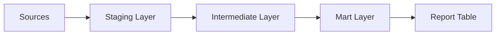

# Tài liệu Kỹ thuật: Module fn_kangnam

Module này được thiết kế để thay thế Stored Function `bc_sales_kangnam()` cũ, chuyển đổi toàn bộ logic xử lý dữ liệu báo cáo Sales Kangnam sang mô hình dbt hiện đại, dễ bảo trì và mở rộng.

## 1. Luồng dữ liệu (Data Flow)

Dữ liệu di chuyển qua 3 tầng xử lý (Layers):

**Source (Nguồn)** -> **Staging (Làm sạch)** -> **Intermediate (Xử lý Logic)** -> **Mart (Báo cáo)**

### Sơ đồ chi tiết:



## 2. Chi tiết từng tầng (Layers)

### 2.1. Staging Layer (`models/fn_kangnam/stg/`)
Nơi tiếp nhận dữ liệu thô từ Source, thực hiện đổi tên cột và lọc rác ban đầu.

*   **`stg_sales_kangnam_base.sql`**:
    *   **Nguồn**: `view_stag_tongquan_khachhang_sm1`, `stag_crm_booking_arrival_company`.
    *   **Logic**:
        *   Lọc bỏ `nhom_dv = 'SAN PHAM'`.
        *   Lấy `chi_nhanh` từ bảng `arrival_company` (ưu tiên) hoặc fallback về bảng gốc.
        *   Đổi tên cột `vao_so` -> `ma_phieu`.

*   **`stg_facebook_pages.sql`**:
    *   **Nguồn**: `cs_chat_api`, `m_facebook_page_kangnam`.
    *   **Logic**: Mapping `ticket_id` sang tên Fanpage (`page_name`).

---

### 2.2. Intermediate Layer (`models/fn_kangnam/int/`)
Nơi thực hiện các phép Join phức tạp và chuẩn hóa dữ liệu dùng chung.

*   **`int_sales_kangnam_clean.sql`**:
    *   **Đầu vào**: `stg_sales_kangnam_base` + `stg_facebook_pages`.
    *   **Nhiệm vụ**:
        1.  **Join Page Name**: Gắn tên Fanpage vào từng bản ghi sales.
        2.  **Chuẩn hóa Email**: Xử lý logic nghiệp vụ đặc thù (Hardcode): Nếu ngày tạo <= 01/06/2024 và email là `anhktn@kangnam.vn` -> đổi thành `anhktn@scigroupvn.com`.
    *   **Kết quả**: Một bảng dữ liệu "sạch", đầy đủ thông tin cơ bản, sẵn sàng để tính toán báo cáo.

---

### 2.3. Mart Layer (`models/fn_kangnam/mart/`)
Nơi tổng hợp dữ liệu cuối cùng phục vụ báo cáo.

*   **`sales_kangnam_mart.sql`**:
    *   **Đầu vào**: `int_sales_kangnam_clean`.
    *   **Logic chính**: Sử dụng kỹ thuật **UNION ALL** để gộp 6 loại dữ liệu lại với nhau (tương tự như Function gốc tách 6 luồng):
        1.  **Lead Total**: Dựa trên `ngay_tao`.
        2.  **Booking**: Dựa trên `ngay_tao` (có điều kiện lọc nhan_vien).
        3.  **Hẹn Lịch**: Dựa trên `ngay_hl`.
        4.  **Đến Cửa**: Dựa trên `ngay_den_cua`.
        5.  **Thành Công**: Dựa trên `ngay_den_cua` (có doanh thu).
        6.  **Doanh Số**: Dựa trên `ngay_tt`.
    *   **Kỹ thuật đặc biệt**: Sử dụng Macro `get_sale_team` để tái sử dụng logic tìm Sale Team theo thời gian (Lateral Join).

---

## 3. Các thành phần hỗ trợ

### 3.1. Macro (`macros/get_sale_team.sql`)
Đây là "vũ khí bí mật" giúp code gọn gàng. Thay vì viết lặp lại đoạn code `LEFT JOIN LATERAL ...` 6 lần, ta gói nó vào Macro.

*   **Input**: Tên cột ngày (ví dụ `ngay_tao`, `ngay_hl`).
*   **Logic**: Tìm nhân viên Sale phụ trách team tại thời điểm đó (dựa vào `table_team_sale_trans_field`).

### 3.2. Cấu hình (`dbt_project.yml`)
*   **Staging & Intermediate**: Materialized là `view` (Không tốn dung lượng, luôn realtime).
*   **Mart**: Materialized là `table` (Lưu cứng xuống DB để query báo cáo cực nhanh).

## 4. Hướng dẫn vận hành

### Chạy toàn bộ module
```bash
dbt run --select fn_kangnam --profiles-dir .
```

### Chạy lại từ đầu (Full Refresh)
Nếu có thay đổi cấu trúc bảng (thêm cột):
```bash
dbt run --select fn_kangnam --full-refresh --profiles-dir .
```

### Kiểm tra dữ liệu (Validation)
So sánh số lượng bản ghi giữa bảng cũ `bc_sales_kangnam` và bảng mới `sales_kangnam_mart`:
```sql
select count(*) from public.bc_sales_kangnam;
select count(*) from public.sales_kangnam_mart;
```
